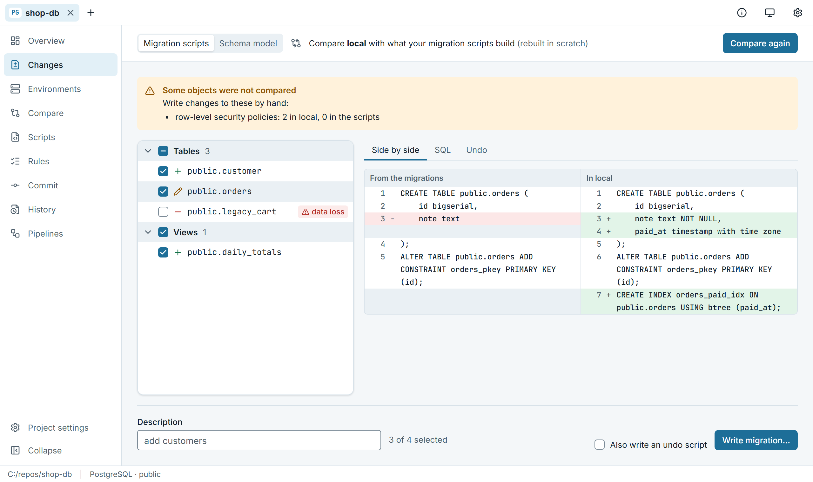

<p align="center">
  <picture>
    <source media="(prefers-color-scheme: dark)" srcset="assets/logo/logo-wordmark-on-dark.png">
    
  </picture>
</p>

# LiftOff

**Plain-SQL database migrations, written from your dev database.**

Change your dev database the way you always do. LiftOff writes the migration script, shows exactly
what it will change, and runs it on every environment. One file to install, nothing else to set
up. PostgreSQL, SQL Server and Oracle. Free and open source (MIT).

**[Get started →](#quick-start)**

<picture>
  <source media="(prefers-color-scheme: dark)" srcset="docs/images/changes-dark.png">
  
</picture>

## Why LiftOff

- **Writing every migration by hand is slow and easy to get wrong.** A column renamed in dev, an
  index added in a hurry, a view changed: someone has to remember it all and write it down as
  SQL. LiftOff compares and writes the script; you review it.
- **Real PostgreSQL setups need care.** A script with `CREATE INDEX CONCURRENTLY` cannot run in a
  transaction, and a migration lock has to work behind PgBouncer in transaction pooling and on
  Aurora Limitless. LiftOff handles both.
- **Setup should be one step.** One program, on a laptop or a CI runner, whatever language the
  rest of your stack is written in.

## How it works

1. **Change your dev database** the way you always do: a GUI, `psql`, an ORM.
2. **`liftoff generate --description "add customers"`** compares it with what your migrations
   build and writes the next script, `V0004__add_customers.sql`, with an undo script if you ask.
   Review it like any other code.
3. **`liftoff -e prod check`, then `liftoff -e prod migrate`.** Check shows drift, what the
   pending scripts change and the exact SQL. Or let the pipeline do both (`liftoff ci`).

## What it does

**What it fixes**

- **One file, nothing to set up.** The `liftoff` program carries what it needs: no runtime or
  database drivers to install, on your machine or a CI runner. The desktop app and the VS Code
  extension run the same program.
- **Safe on real PostgreSQL.** Scripts that cannot run in a transaction (`CREATE INDEX
  CONCURRENTLY`, `VACUUM`) run outside one, and waiting for the lock never holds a transaction open,
  so they do not hang. Behind PgBouncer, RDS Proxy or on Aurora Limitless, `lock = "table"` in
  `liftoff.toml` uses a lease row instead of an advisory lock.
- **The migration is written for you.** From the dev database or the schema-model files, with
  views, functions, triggers and the rest. `--dry-run` everywhere: see the SQL before it runs.
- **Undo is included.** `generate --undo` writes the undo script; `liftoff -e test undo` runs it.
- **Years of scripts, one clean start.** `liftoff rebaseline` replaces old scripts with one
  baseline script, checked to build the same schema; `liftoff squash --up-to 120` folds in part
  of them.
- **Placeholders per environment.** `${owner}` in a script, a value per environment in
  `liftoff.toml`, secrets from environment variables.
- **Reports only when you ask.** `check --report report.html` writes one; nothing else lands on
  disk.

**And everything you expect**

- **Versioned migrations.** `V0001__orders.sql`, `U0001__orders.sql` (undo), `R__views.sql`
  (repeatable), `B0001__baseline.sql`. A history table per database, checks that scripts were not
  edited after they ran. A hotfix? `migrate --only 5` runs one script and nothing else.
- **Schema model.** One file per database object in `schema-model/`, so git shows the history of
  every table and view.
- **Compare.** The schema of any two: environments, the schema model, what the migrations build, a
  saved snapshot, any database by URL. The rows of two databases too, fast on big tables, with the
  INSERT / UPDATE / DELETE script that makes them match. Tables without a key (heaps) are
  compared as whole rows, duplicates included.
- **Pipelines.** `liftoff ci` writes a GitHub Actions workflow: pull requests get their migration
  script written (or required) and numbered after main; merges deploy through your environments.
- **Three ways in.** The command line (every command also answers in JSON), a desktop app, and a
  VS Code extension.
- **Offline.** The program only talks to your databases (and, for Azure SQL with Microsoft Entra
  ID, to Microsoft's sign-in service). Your CI runners only need to reach your databases.

## Price

Free. MIT licence, no editions, no account, no licence key, no seat count. Everything on this page
is included.

## Quick start

```sh
liftoff init --name shop --engine postgresql      # writes liftoff.toml and migrations/
# add an environment to liftoff.toml:
#   [environments.test]
#   url = "postgres://app@db-test:5432/shop"
#   role = "test"
liftoff -e test info
liftoff -e test migrate
```

`liftoff --help` lists every command; `liftoff <command> --help` explains one. Every command
takes `--output-type json` for scripts and pipelines. To try it without a project:
`liftoff init --sample`.

**[The documentation](docs/README.md)** has the user guide and step-by-step tutorials for a new
database and for an existing one, on the command line, in the desktop app and in VS Code.

## How a project goes

**A new database.** The first script is `V0001`, the next `V0002`, and so on. Every database is
built from the scripts.

**An existing database.** Start from what is there: `liftoff -e prod adopt` captures the database
that is right (usually production) into `B0001`, checks on the scratch database that it rebuilds
exactly that, and records it as already there. New scripts start at `V0002`. Other environments
that already have objects are checked against `B0001` on their next `migrate`:

- the same: the baseline is recorded, nothing runs;
- objects missing: they are created, then the baseline is recorded;
- objects that differ: it stops and lists them, and nothing changes until you decide
  (fix them, or `--accept-differences`: they are kept and show up as drift).

Empty databases are simply built from `B0001`.

**Branches.** Every pull request checks that its new scripts are numbered after everything on the
main branch; when the pipeline writes the script, it renumbers it (`liftoff renumber`).

**Many scripts.** `liftoff rebaseline` replaces the scripts with one baseline script (checked to
build the same schema) and takes the old ones out of the folder; git still has them. From
`V9990` on, migrate and the apps say it is time for `liftoff rebaseline --restart`: the baseline
becomes `B0001` again, and each existing database goes through the same check on its next run.

## Questions

**I already use Flyway. Can I bring my project?** Yes. `liftoff init --from-flyway` converts
`flyway.toml` / `flyway.conf` (the originals stay), the scripts keep their names and checksums,
Flyway-style `-key=value` options are accepted, and `import-flyway-history` copies an existing
`flyway_schema_history` table once (PostgreSQL; on SQL Server, baseline instead).

**My database was never under a migration tool.** `liftoff -e prod adopt`, as above.

**What does generating or comparing need?** A scratch database: an empty database on any server
you have, which LiftOff rebuilds from your scripts to compare against. `liftoff create-scratch`
makes one next to your dev database.

**Does it send anything anywhere?** No. No telemetry, no LiftOff account. Two exceptions: signing
in to Azure SQL with Microsoft Entra ID talks to Microsoft's sign-in service, as any SQL Server
tool does; and the desktop app asks GitHub whether there is a newer LiftOff (switch it off under
Settings > This app). The command line never checks for updates. Passwords go to
your operating system's keychain or come from environment variables, never into `liftoff.toml`.

**Is it ready for production?** It is new (version 0.1). The tests run against real PostgreSQL,
PgBouncer and SQL Server on every change. Try it on a test environment first, and
[open an issue](../../issues) for anything that surprises you.

## Get started

From [Releases](../../releases), download one of:

- **the desktop app**: `LiftOff-Setup-<version>.exe` (Windows, a setup wizard that also puts `liftoff`
  on your PATH) or `LiftOff-<version>-x86_64.AppImage` (Linux). There is no desktop app for macOS;
  on a Mac, use the command-line program or the VS Code extension;
- **the VS Code extension**: `liftoff-vscode-<platform>.vsix`;
- **the command-line program only**: `liftoff-<platform>`, one file.

Each includes everything it needs. Then follow the [quick start](#quick-start) or a
[tutorial](docs/tutorials/README.md). Details: [Installing](docs/guide/installing.md).

## The repository

| folder | what |
| --- | --- |
| `packages/liftoff` | the core (runner, comparison, schema model, CI) and the CLI, in TypeScript on Node 24 |
| `apps/desktop` | the desktop app: Electron + React |
| `apps/vscode` | the VS Code extension; runs the CLI and reads its JSON |
| `e2e` | Playwright tests for the desktop app |

[CONTRIBUTING.md](CONTRIBUTING.md) explains how to build it and run the tests.

## Not affiliated

LiftOff is an independent project, written from scratch. It is not affiliated with or endorsed by
Redgate Software. Flyway is a trademark of Red Gate Software Ltd; it is named here only to say
which projects LiftOff can read.

## Licence

[MIT](LICENSE).
